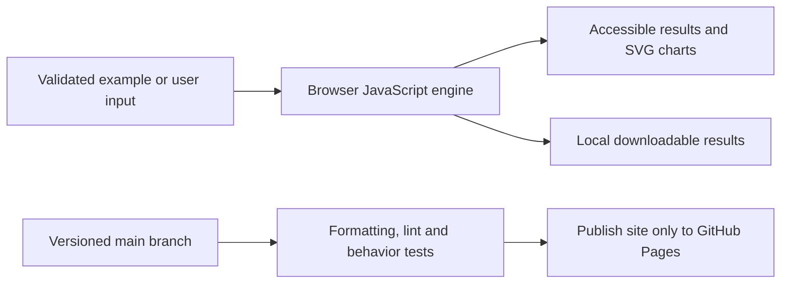

# Concrete Mix Design Lab

[Open the application](https://subhashdixit.github.io/concrete-mix-design-lab/) · [Report an issue](https://github.com/subhashdixit/concrete-mix-design-lab/issues)

Turn concrete proportioning into an explicit, unit-labelled trial-mix calculation. The original grade/table calculator is preserved for historical comparison; this maintained release focuses on inspectable absolute-volume and moisture arithmetic.

## What the finished application does

- Choose water/binder assumptions, SCM fraction, specific gravities, air and aggregate split.
- Visualize the one-cubic-metre volume balance.
- Calculate SSD and wet batch aggregate masses, corrected water addition and selected batch scaling.
- Export all assumptions and calculated results.

## Use the application step by step

1. Open the live application. Read the input labels and scope panel.
2. Start with the included example to understand the output.
3. Replace it with your own supported input. Files are processed locally unless you explicitly choose a server feature and consent to it.
4. Run the analysis and inspect the visual output together with its limitations.
5. Export your results when the tool offers a download. Keep your own copy; a browser tab is not a durable data store.

## Concepts, algorithms and interpretation

### Mass → absolute volume → aggregate balance

Binder = water / water-binder ratio. Split binder into cement and SCM. Absolute material volume = mass / (specific gravity × 1000 kg/m³). Remaining aggregate volume = 1 − water volume − cement volume − SCM volume − air volume. Split that volume by the user-chosen fine fraction, then multiply by SSD aggregate density. For water 180 kg and w/b 0.50, binder is 360 kg; cement at SG 3.15 occupies 360/3150 = 0.114286 m³ when there is no SCM.

### Moisture correction

Absorption and total moisture are both percentages of oven-dry mass. Oven-dry mass = SSD mass / (1 + absorption). Wet batch mass = oven-dry mass × (1 + total moisture). Aggregate free water = oven-dry mass × (total moisture − absorption). Water to add = design free water − sum of aggregate free water. Dry aggregates have negative free water and need additional water; wet aggregates supply some mixing water. The tests verify this water balance independently of the plotted volumes.

### What this calculation does not select

Strength, durability, exposure limits, grading, pumpability, admixture water and material compatibility require laboratory measurements and applicable engineering standards. This implementation does not reproduce unverified normative tables or claim code compliance. A volume balance can be mathematically correct and still make poor concrete. Obtain trial batches and qualified review before construction use.

## Architecture and data flow



HTML provides the accessible page structure, CSS handles responsive layout, and ES modules separate calculation from user interaction. Pure calculation functions can run in Node tests without a browser. SVG charts scale with the screen; they use explicit axes, labels and legends. CSV exports escape spreadsheet formula prefixes in text cells.


## Run locally from scratch

Install Node.js 22 and Python 3 for a local static HTTP server. Python is not a production backend for this app.

```bash
git clone https://github.com/subhashdixit/concrete-mix-design-lab.git
cd concrete-mix-design-lab
npm ci
npm test
npm run lint
npm run format
npm run check
python3 -m http.server 8000 --directory site
```

Open http://localhost:8000. Use HTTP rather than double-clicking HTML so that module imports and local data fetches work consistently. No production API secret belongs in `site/`.

## Coding structure

```text
site/
  index.html       # accessible application interface
  styles.css       # responsive design
  app.js           # interface orchestration
  engine.js        # validated calculations; no DOM dependency
  ui.js            # chart, CSV and download helpers
tests/             # behavior and boundary cases
.github/workflows/pages.yml
archive/           # original README and retired workflows where present
```

Original source files, notebooks and historical artifacts remain in the repository for comparison. The release publishes only `site/`; old source directories and datasets are not automatically exposed by the application.

## CI/CD and deployment

CI means continuous integration: each pull request and main-branch push installs exact lockfile dependencies, checks formatting, lints JavaScript, runs meaningful behavior tests and checks module syntax. A failed check stops publishing. CD means continuous deployment: after the required `Build and test` check succeeds on `main`, GitHub Actions uploads `site/` and GitHub Pages serves it over HTTPS.

The workflow uses pinned action revisions, minimal permissions and a protected main branch. Publishing jobs need Pages/OIDC permissions; test jobs only read source. Feature branches are deleted after merge. Static Pages hosting needs no always-running Python process, but cannot hide secrets, host a Flask process or provide durable server storage.

To set up a fork, enable GitHub Pages with **GitHub Actions** as its source and allow the repository's workflow to run. Repository Settings → Pages shows the deployment URL. If renaming the repository, update the README URL and any absolute links; application resources use relative paths. Check Actions logs if publishing fails.

### Release, monitoring and rollback

A commit identifies exactly which source was deployed. Inspect the Actions deployment and test results before sharing the link. After publishing, open the page, run its example and check exports; a successful HTTP response alone is not a functional test. For rollback, revert the faulty merge in a new PR, pass checks, and merge the revert. This triggers the same reproducible publishing process. Avoid force-pushing protected main or deleting history. Browser caches can retain an older asset briefly; refresh after a deployment.

### Docker and alternatives

Docker packages code and dependencies into a reproducible runtime. This static app does not require a container: Pages serves the same versioned files directly, with less operating work and no container cold starts. A container becomes useful if adding a Python backend; then secrets, patches, resource costs and persistent storage require separate management.

## Data provenance and attribution

Original mixdesigncalculator.github.io HTML/JavaScript remains in source. The non-resolving original custom-domain declaration is preserved in archive/original-CNAME; the maintained app uses its free GitHub Pages domain. No DNS records were changed. The maintained formulas express standard mass/volume and moisture balance, with all empirical design choices supplied by the user.

## Practical limits

Educational trial proportions only. Specific gravity convention must match SSD aggregate masses. No chemical admixture, admixture-water or temperature correction. If aggregate moisture exceeds needed water, the tool rejects rather than returning negative added water. Water/binder ratio is a supplied assumption, not a prediction of compressive strength.

The test suite checks calculation contracts and invalid inputs. It cannot establish that an input dataset is representative, that a heuristic is scientifically correct for every domain, or that a result is suitable for an automated consequential decision. Read the original source alongside the maintained browser implementation when comparing behavior.

The old custom domain did not resolve during deployment verification, so it has been detached from Pages. To restore a domain later, first configure its DNS and verify ownership in Pages settings.
